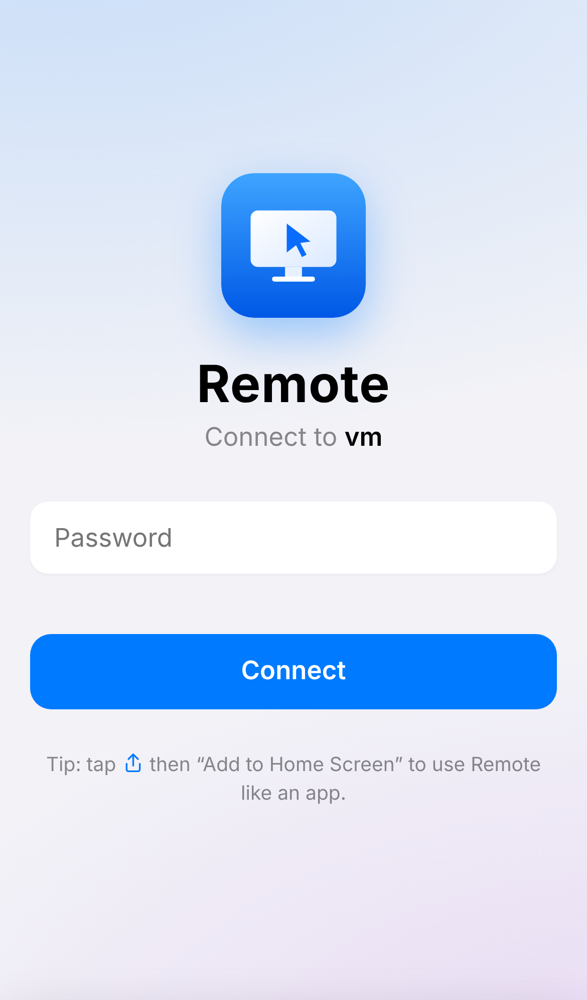
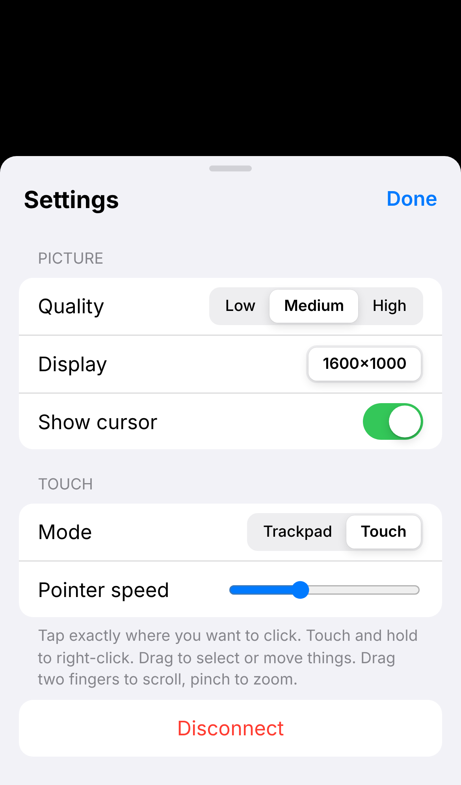
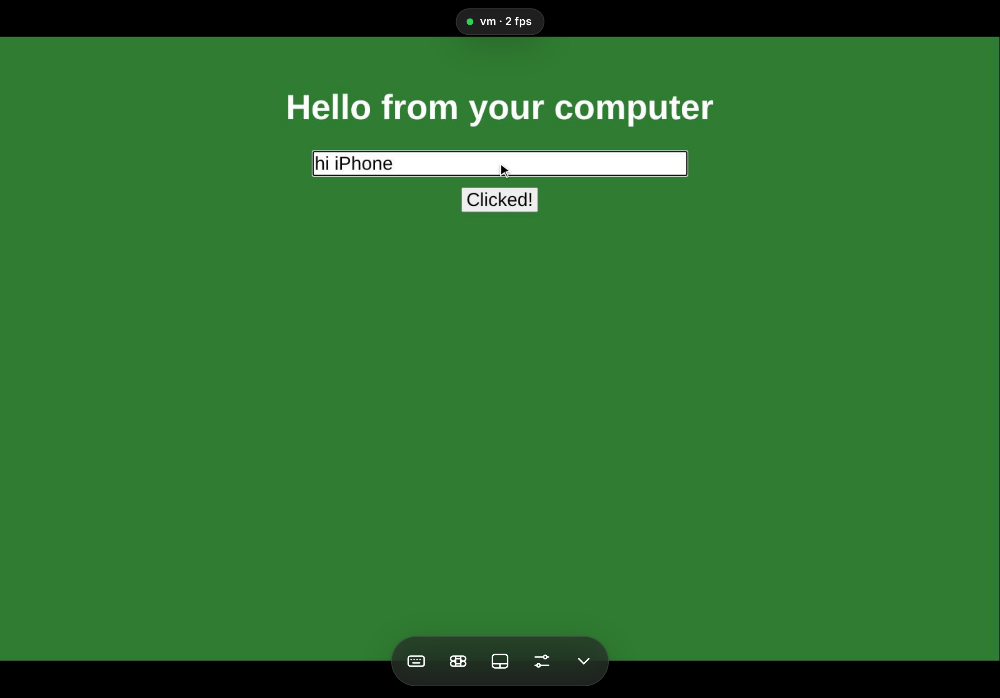

# Remote: control your computer from your iPhone or iPad

Remote is a small web app. You run one program on your computer, then open a web page on your iPhone or iPad to see the computer's screen and control it with your fingers and keyboard. You don't need anything from the App Store.

<p>
  
  
</p>


---

## 1. Start it on your computer

You need **Python 3.10 or newer**. If you don't have it, get it from [python.org/downloads](https://www.python.org/downloads/). On Windows, tick **"Add Python to PATH"** during install.

| Computer | What to do |
|---|---|
| **Mac** | Double-click `start-mac.command`. If macOS blocks it, right-click it, choose **Open**, then **Open** again. |
| **Windows** | Double-click `start-windows.bat`. |
| **Linux** | Run `./start-linux.sh` in a terminal. |

The first run installs a few things, which takes about a minute. Then it asks you to **choose a password**, which you'll type on your phone. It prints something like:

```
  Remote is running. Open one of these on your iPhone or iPad:

    http://localhost:8765
    http://192.168.1.20:8765   (same Wi-Fi)
```

Keep that window open. Closing it turns Remote off.

### Mac only: give permission (one time)

macOS asks for permission before an app can see or control your screen. Open **System Settings → Privacy & Security** and turn on **Terminal** (or Python) under both:

* **Screen & System Audio Recording**: lets Remote see the screen
* **Accessibility**: lets Remote move the mouse and type

Then close the Remote window and start it again.

## 2. Try it at home (same Wi-Fi)

On your iPhone or iPad, open **Safari** and type the `http://192.168.x.x:8765` address that was printed. Enter your password and you're in.

**Make it feel like an app:** in Safari, tap the **Share** button, then **Add to Home Screen**. You'll get a "Remote" icon that opens full screen with no browser bars.

## 3. Use it from anywhere in the world (Tailscale)

The safest easy way is **Tailscale**. It's free for personal use and builds a private, encrypted link between your own devices. You don't have to change any router settings, and nothing is exposed to the public internet.

1. Install Tailscale on your **computer** from [tailscale.com/download](https://tailscale.com/download) and sign in.
2. Install the **Tailscale** app on your **iPhone and iPad** from the App Store and sign in with the **same account**.
3. In the Tailscale app on your phone, find your computer's name, for example `my-mac`.
4. In Safari, open **`http://my-mac:8765`**. You can also use the `100.x.y.z` address Tailscale shows for your computer.

That's it. It works on 4G/5G, hotel Wi-Fi, or anywhere else, as long as the computer is **on, awake, and running Remote**.

> 💡 Stop your computer from sleeping: on Mac, go to *System Settings → Displays → Advanced → Prevent automatic sleeping*. On Windows, go to *Settings → System → Power → Sleep: Never*.

> ⚠️ Please **don't** open port 8765 on your router. That would put your computer on the public internet over plain `http`. Use Tailscale instead.

## How to control it

There are two touch modes. Switch between them with the toolbar button or in **Settings**.

**Trackpad mode** (default, best on iPhone): your screen works like a laptop trackpad.

| Gesture | Does |
|---|---|
| Drag one finger | Move the pointer |
| Tap | Left click (tap twice to double-click) |
| Tap, then touch again and drag | Click-and-drag (select text, move windows) |
| Tap with two fingers | Right click |
| Drag two fingers | Scroll |
| Pinch | Zoom in/out (the view follows the pointer) |

**Touch mode** (great on iPad): you tap things directly.

| Gesture | Does |
|---|---|
| Tap | Click right there |
| Touch and hold | Right click |
| Drag one finger | Click-and-drag |
| Drag two fingers / pinch | Scroll / zoom |

**iPad with Magic Keyboard or a mouse:** the trackpad, mouse, scrolling and hardware keyboard all work directly.

**Toolbar buttons** at the bottom, from left to right:

* ⌨️ **Keyboard**: shows the on-screen keyboard
* ⌘ **Special keys**: shows Ctrl, Alt, ⌘/Windows, Shift, Esc, Tab, arrows, and F-keys. Tap a modifier (it turns blue), then a key. For example, **ctrl** then **c** copies.
* ▭ **Mode**: switches between Trackpad and Touch
* ⚙︎ **Settings**: picture quality, which display to show, pointer speed, and Disconnect
* ⌄ **Hide**: hides the toolbar for full-screen viewing. Tap the small arrow to bring it back.

**Picture quality:** pick **Low** on slow mobile data and **High** on fast Wi-Fi.

## Good to know

* **Change your password:** start it with `--reset-password`. For example, on Mac/Linux run `./start-linux.sh --reset-password`.
* **Different port:** add `--port 9000`.
* **Security:** the password is never stored in plain text. After 5 wrong attempts, that device is locked out for 5 minutes.
* **Linux:** this needs an **X11** desktop. It doesn't work with Wayland, which is the default on newer Ubuntu. On the Ubuntu login screen, click ⚙ and pick "Ubuntu on Xorg".
* **Windows:** Remote can't click on admin pop-ups ("Do you want to allow this app…") or the lock screen. That's a Windows security rule.
* **Sound and file transfer** aren't included. This is a simple screen and control app.

## What's inside

| File | What it is |
|---|---|
| `server.py` | The program that runs on your computer. It captures the screen, sends it to your phone, and moves the mouse and keyboard. |
| `static/index.html` | The app's screens: sign-in, remote view, settings |
| `static/styles.css` | The iOS look: frosted glass, iOS colors and controls, light and dark mode |
| `static/app.js` | Touch gestures, keyboard, and talking to the computer |
| `start-*.{command,bat,sh}` | Double-click starters for each computer type |

How it works: your phone signs in with your password. The computer then sends JPEG pictures of its screen over a WebSocket, sending a new one only when something changes. Your taps go back the other way as small messages.
